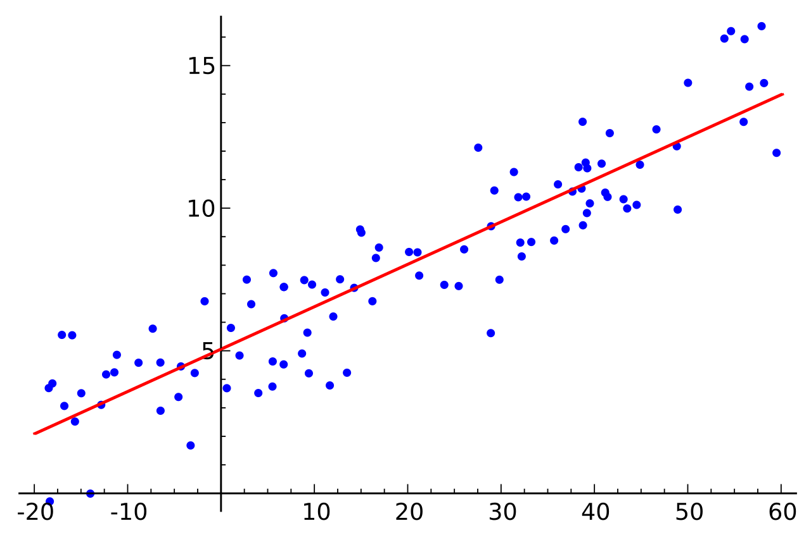
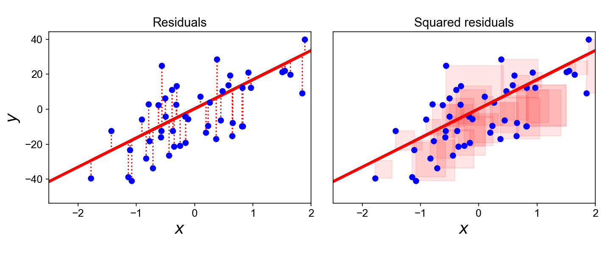
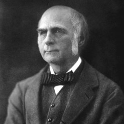
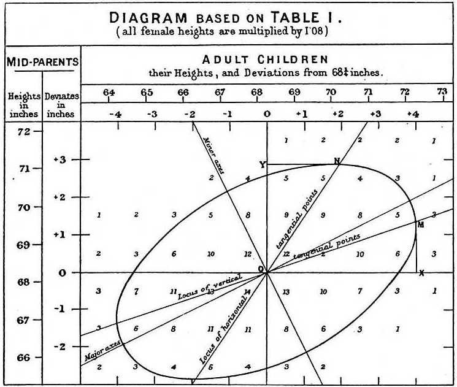
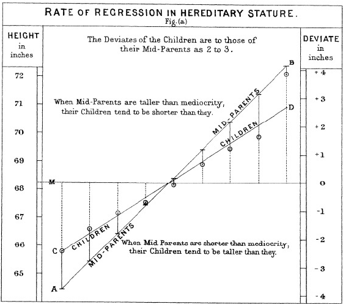

```{r setup, include=FALSE}
knitr::opts_chunk$set(echo = TRUE, warning = F)
img_path <- "regfigs/"
```

## Introduction to Regression
\Large
We often want to know how two or more variables are related.

* Example: which baseball player statistics predict team success, to build a team on a limited budget?
* First, the core concepts of regression.

## Introduction to Regression
\Large
**Regression** estimates the relationship between:

* a **dependent variable**: outcome, response, or *label* in ML
* one or more **independent variables**: predictors, covariates, or *features* in ML

## Introduction to Regression
\Large
The most common form is **linear regression**: find the line (or linear combination) that best fits the data under a chosen criterion.

## Introduction to Regression
\Large
In math class, a line is (slope $m$, intercept $b$):
$$y=mx+b.$$

In statistics, we write:
$$y_i=\beta_0+x_i\beta_1 ,$$
with slope $\beta_1$, intercept $\beta_0$, and observed data points $(x_i, y_i)$.

## Introduction to Regression
\Large
* In math, lines fit the points _exactly_
* In statistics, points _do not_ fall exactly on the line
* We find the __best fit__ line to estimate the unknown slope and intercept: a **linear regression model**

## Introduction to Regression
\center
{height='70%'}


## Introduction to Regression
\Large
Formally, we observe $n$ data pairs
$${(x_i, y_i), i = 1, ..., n},$$
and model
$$y_i=\beta_0+x_i\beta_1 +\epsilon_i.$$

* $\epsilon_i$ are the **errors** (deviations from the line)
* $\beta_0$ and $\beta_1$ are unknown and must be _estimated_ from the data


## Introduction to Regression
\Large
Goal: find estimates $\hat\beta_0$ and $\hat\beta_1$ that "best fit" the data.

__Least squares__: minimize the sum of squared residuals
$$\min_{\beta_0,\beta_1}Q(\beta_0,\beta_1) =  \underset{\beta_0,\beta_1}\inf\left\{\sum_{i=1}^n(y_i-\beta_0-x_i\beta_1)^2\right\}=\inf_{\beta_0,\beta_1}\sum_{i=1}^n \epsilon_i^2.$$

## Introduction to Regression
\Large
The least squares estimator (LSE) is the most common choice because of its properties:

* It is the _best linear unbiased estimator_ (Gauss-Markov)
* No other linear unbiased estimator has smaller sampling variance for $\hat\beta_0$ and $\hat\beta_1$

## Introduction to regression


## Case study: is height hereditary?
\Large
Francis Galton^[https://en.wikipedia.org/wiki/Francis_Galton] studied heredity using family height data. Along the way, he developed **correlation** and **regression**.

\center
{ width=20% }


## Case study: is height hereditary?
\Large
Galton's question: how well can we predict a child's height from the parents' heights? His answer: **regression**!

__Historical note__: Galton also promoted eugenics, a scientifically flawed movement with horrific consequences: [https://pged.org/history-eugenics-and-genetics/](https://pged.org/history-eugenics-and-genetics/).

## Case study: is height hereditary?
\Large
Galton's data are in `HistData`. Keep each father and one randomly selected son:

\footnotesize
```{r, message=FALSE, warning=FALSE, echo=TRUE}
library(tidyverse)
library(HistData)
data("GaltonFamilies")

set.seed(1983)
galton_heights <- GaltonFamilies %>%
  filter(gender == "male") %>%
  group_by(family) %>%
  sample_n(1) %>%
  ungroup() %>%
  select(father, childHeight) %>%
  rename(son = childHeight)
```

## Case study: is height hereditary?

Both distributions are approximately normal, so summarize with means and SDs:
\small
```{r, echo=TRUE}
galton_heights %>%
  summarize(mean(father), sd(father), mean(son), sd(son))
```

But this misses the key feature: taller fathers have taller sons.

## Case study: is height hereditary?

```{r scatterplot, fig.height = 3, fig.width = 3, out.width="40%", echo=TRUE, fig.align="center"}
galton_heights %>% ggplot(aes(father, son)) +
  geom_point(alpha = 0.5)
```


## Case study: is height hereditary?
\Large
Correlation between father and son heights:

```{r}
galton_heights %>%
    summarize(r = cor(father, son)) %>%
    pull(r)
```

## Case study: is height hereditary?

Fit the least squares model with `lm`:
$$
y_i = \beta_0 + x_i \beta_1 + \varepsilon_i
$$
($y_i$ = son's height, $x_i$ = father's height)
```{r, echo=TRUE}
fit <- lm(son ~ father, data = galton_heights)
fit$coef
```

## Case study: is height hereditary?
`summary` gives more detail about the fit:
\scriptsize
```{r}
summary(fit)
```

## Case study: is height hereditary?
Plot $\hat{Y}$ with confidence intervals in `ggplot2`:
\small
```{r father-son-regression, fig.height = 3, fig.width = 3, out.width="40%", fig.align="center",message=FALSE}
galton_heights %>% ggplot(aes(father, son)) +
  geom_point() + geom_smooth(method = "lm")
```

## Case study: is height hereditary?
\Large
`predict` returns predictions from an `lm` object, plus standard errors if requested:

\scriptsize
```{r father-son-predictor}
fit <- galton_heights %>% lm(son ~ father, data = .)
y_hat <- fit %>% predict(se.fit = TRUE)
names(y_hat)
```


## Introduction to Regression
\Large
Extend to $p$ predictors:
$$y_i=x_{i1}\beta_1+\ldots+x_{ip}\beta_p+\epsilon_i=\sum_{j=1}^{p}x_{ij}\beta_j+\epsilon_i.$$

To include an intercept, make one predictor constant ($x_{ij}=1$ for all $i$), so $x_{ij}\beta_j=\beta_0$.

## Introduction to Regression
**Multiple regression** on the full dataset:
\tiny
```{r, message=FALSE, warning=FALSE, echo=TRUE}
fit2 <- GaltonFamilies %>%
  lm(childHeight ~ mother + father + gender + children, data = .)
fit2 %>% summary()
```

## Introduction to Regression
Interpreting the model:

* Intercept: $\beta_0$ = 17.4 inches (p = `5.08e-10`)
* Each inch of mother's height: +0.32 inches (p < `2e-16`)
* Each inch of father's height: +0.39 inches (p < `2e-16`)
* Male vs. female (reference): +5.2 inches (p < `2e-16`). _R uses the first factor level (alphabetical) as the reference._
* Number of children: not significant (p = 0.0825)
* $R^2=0.637$ (adjusted 0.635): `father`, `mother`, and `gender` are moderately strong predictors

## Introduction to Regression
\Large
In matrix form, with outcome ${\bf y}=(y_1, \ldots, y_n)$, predictor matrix ${\bf X}$, and coefficients $\beta$ ($p\times 1$):
$${\bf y}=X\beta+\epsilon, \quad \epsilon\sim N({\bf 0},\sigma^2 I_n).$$

## Introduction to Regression
\Large
Least squares then minimizes:
$$\hat\beta=\underset{\beta}\inf\left\{\sum_{i=1}^{n}(y_i-\sum_{j=1}^{p}x_{ij}\beta_j)^2\right\}=\underset{\beta}\inf\left\{({\bf y}-{\bf X}\beta)'({\bf y}-{\bf X}\beta)\right\}$$

## Diversion: Maximum Likelihood for a Normal mean
\Large
Let $x_1, \ldots, x_N$ be independent Normal($\mu,\sigma^2$), with $\sigma^2$ known. The likelihood is
$$L(\mu|{\bf x})=\left\{\frac{1}{2\pi\sigma^2}\right\}^{N/2}exp\left\{-\frac{1}{2\sigma^2}\sum_{i=1}^{N}(x_i-\mu)^2\right\}$$\pause
Maximizing $L(\mu|{\bf x})$ = minimizing $\sum_{i=1}^{N}(x_i-\mu)^2$ over $\mu$.

## Diversion: Maximum Likelihood for a Normal mean
\Large
Note the following:
\[
\begin{aligned}
\sum_{i=1}^{N}(x_i-\mu)^2 &= \sum_{i=1}^{N}(x_i^2-2\mu x_i+\mu^2)\\\pause
  &= \sum_{i=1}^{N}x_i^2-2\mu\sum_{i=1}^{N}x_i+N\mu^2\\\pause
\end{aligned}
\]

## Diversion: Maximum Likelihood for a Normal mean
therefore:
\[
\begin{aligned}
\frac{\partial}{\partial\mu} &=-2\sum x_i+2N\hat\mu\stackrel{set}{=}0\\\pause
  &\Rightarrow N\hat\mu = \sum x_i\\\pause
  &\Rightarrow \hat\mu = \frac{\sum x_i}{N}
\end{aligned}
\]


## Diversion: Maximum Likelihood for Regression
\Large
Recall the regression model:
$${\bf y}=X\beta+\epsilon, \quad \epsilon\sim N({\bf 0},\sigma^2 I_N).$$

## Diversion: Maximum Likelihood for Regression
\Large
Extending the Normal mean MLE: $$\sum_{i=1}^{N}(y_i-x_{i1}\beta_1-\ldots-x_{ip}\beta_p)^2=({\bf y}-{\bf X}\beta)'({\bf y}-{\bf X}\beta),$$\pause
so
$$L(\beta|{\bf X},{\bf y})=\left\{\frac{1}{2\pi\sigma^2}\right\}^{N/2}exp\left\{-\frac{1}{2\sigma^2}({\bf y}-{\bf X}\beta)'({\bf y}-{\bf X}\beta)\right\}.$$
Maximizing the likelihood = minimizing the sum of squared errors!

## Diversion: Maximum Likelihood for Regression
\Large
Note
$$({\bf y}-{\bf X}\beta)'({\bf y}-{\bf X}\beta)={\bf y}'{\bf y}-2\beta'{\bf X}'{\bf y}+\beta'{\bf X}'{\bf X}\beta,$$\pause
and therefore
\[
\begin{aligned}
\frac{\partial}{\partial\beta} &=-2{\bf X}'{\bf y}+2{\bf X}'{\bf X}\hat\beta \stackrel{set}{=}0\\\pause
  &\Rightarrow {\bf X'X}\hat\beta = {\bf X'y}\\\pause
  &\Rightarrow {\bf (X'X)}^{-1}{\bf X'X}\hat\beta = {\bf (X'X)}^{-1}{\bf X'y}\\\pause
  &\Rightarrow \hat\beta = {\bf (X'X)}^{-1}{\bf X'y}
\end{aligned}
\]

## Diversion: Maximum Likelihood for Regression
\Large
Now note:
\[
\begin{aligned}
E[\hat\beta] &= E[{\bf (X'X)}^{-1}{\bf X'y}] \\\pause
  &= {\bf (X'X)}^{-1}{\bf X'}E[{\bf y}]\\\pause
  &= {\bf (X'X)}^{-1}{\bf X'X\beta}\\\pause
  &= \beta
\end{aligned}
\]

## Diversion: Maximum Likelihood for Regression
\Large
And, remembering that $$Var[{\bf Ay}]={\bf A}\{Var[{\bf y}]\}{\bf A'},$$
so therefore,
\[
\begin{aligned}
Var[\hat\beta] &= Var[{\bf (X'X)}^{-1}{\bf X'y}] \\\pause
  &= {\bf (X'X)}^{-1}{\bf X'}\{Var[{\bf y}]\}{\bf X}{\bf (X'X)}^{-1}\\\pause
  &= {\bf (X'X)}^{-1}{\bf X'}\{\sigma^2 I_N\}{\bf X}{\bf (X'X)}^{-1}\\\pause
  &= \sigma^2{\bf (X'X)}^{-1}{\bf X'X}{\bf (X'X)}^{-1}\\\pause
  &= \sigma^2{\bf (X'X)}^{-1}.
\end{aligned}
\]

Estimate $\sigma^2$ with:
$$\hat\sigma^2=\frac{1}{N-p-1}({\bf y}-X{\bf\hat\beta})'({\bf y}-X{\bf\hat\beta})$$

## Diversion: Maximum Likelihood for Regression
\Large
Test $H_0: \beta_j=0$ vs. $H_a: \beta_j \ne 0$ with:

$$t_{\beta_j} = \frac{\hat\beta_j}{\hat\sigma\sqrt{v_{jj}}},$$
where $v_{jj}$ is the $j$th diagonal of ${\bf V={\bf (X'X)}^{-1}}$. Under $H_0$, $t_{\beta_j} \sim t_{N-p-1}$.


<!--
## Case study: is height hereditary?
\center

-->


## Case study: is height hereditary?
\Large
Using our estimator: <!-- and $\hat\sigma^2$: -->

$${\bf\hat\beta} = (X'X)^{-1}X'{\bf y}$$ <!--, Var({\bf\hat\beta})=\sigma^2(X'X)^{-1}, \mbox{ and }$$ --> <!--$$\hat\sigma^2=\frac{1}{N-p-1}({\bf y}-X{\bf\hat\beta})'({\bf y}-X{\bf\hat\beta})$$ -->
\normalsize
```{r}
X <- cbind(1,galton_heights$father)
y <- galton_heights$son
beta_hat <- solve(t(X)%*%X)%*%t(X)%*%y
beta_hat
```

## Case study: is height hereditary?
Predicted values: $\hat y = X\hat\beta$
\scriptsize
```{r, ,fig.height = 3, fig.width = 3, out.width="30%", fig.align="center"}
y_hat <- X %*% beta_hat

galton_heights %>% ggplot(aes(father, son)) +
  geom_point(alpha = 0.5) +
  geom_point(aes(y = y_hat), col = "red") +
  geom_abline(slope = 1, intercept = 0)
```

## Case study: is height hereditary?
\center
{width=50%}


## Case study: is height hereditary?
Standard error for hypothesis testing:
$$SE({\hat\beta_i})=\hat\sigma \sqrt{v_{ii}},$$ where $v_{ii}$ is the $i$th diagonal element of $(X'X)^{-1}$, and $$\hat\sigma^2=\frac{1}{N-p-1}({\bf y}-X{\bf\hat\beta})'({\bf y}-X{\bf\hat\beta})$$

```{r}
N <- length(y)
p <- length(beta_hat)
sigma2_hat <- 1 / (N - p - 1) *
  t(y - X %*% beta_hat) %*% (y - X %*% beta_hat)
V <- solve(t(X) %*% X)
Z2 <- beta_hat[2] / sqrt(sigma2_hat * V[2, 2])
Z2
```


## The Regression Fallacy
\Large

The _sophomore slump_ (Wikipedia): \vskip .2in

> A second, or sophomore, effort fails to live up to the standards of the first: students, athletes (second season), bands (second album), TV shows, and movie sequels.

## The Regression Fallacy
\Large
* MLB's Rookie of the Year (ROY) goes to the best first-year player
* ROY winners often do worse in year two: the "sophomore slump"
* Fox Sports^[http://www.foxsports.com/mlb/story/kris-bryant-carlos-correa-rookies-of-year-award-matt-duffy-francisco-lindor-kang-sano-120715]: "Will MLB's tremendous rookie class of 2015 suffer a sophomore slump?"

## The Regression Fallacy
\Large
Is it real? Batting averages for the top ROYs do drop:

<!--The data is available in the Lahman library, but we have to do some work to create a table with the statistics for all the ROY. First we create a table with player ID, their names, and their most played position.-->

```{r, echo=FALSE, message=FALSE, warning=FALSE}
library(tidyverse)
library(Lahman)
playerInfo <- Fielding %>%
  group_by(playerID) %>%
  arrange(desc(G)) %>%
  slice(1) %>%
  ungroup %>%
  left_join(People, by="playerID") %>%
  select(playerID, nameFirst, nameLast, POS)
```


<!--
Now, we will create a table with only the ROY award winners and add their batting statistics. We filter out pitchers, since pitchers are not given awards for batting and we are going to focus on offense. Specifically, we will focus on batting average since it is the summary that most pundits talk about when discussing the sophomore slump:
-->

```{r, echo=FALSE}
ROY <- AwardsPlayers %>%
  filter(awardID == "Rookie of the Year") %>%
  left_join(playerInfo, by="playerID") %>%
  rename(rookie_year = yearID) %>%
  right_join(Batting, by="playerID") %>%
  mutate(AVG = H/AB) %>%
  filter(POS != "P")
```

<!--
We also will keep only the rookie and sophomore seasons and remove players that did not play sophomore seasons:
-->
```{r, echo=FALSE}
ROY <- ROY %>%
  filter(yearID == rookie_year | yearID == rookie_year+1) %>%
  group_by(playerID) %>%
  mutate(rookie = ifelse(yearID == min(yearID), "rookie", "sophomore")) %>%
  filter(n() == 2) %>%
  ungroup %>%
  select(playerID, rookie_year, rookie, nameFirst, nameLast, AVG)
```

<!--
Finally, we will use the `spread` function to have one column for the rookie and sophomore years batting averages:
-->

```{r, echo=FALSE}
ROY <- ROY %>% spread(rookie, AVG) %>% arrange(desc(rookie))
tmp <- ROY %>% slice(1:5) %>%
  select(nameFirst, nameLast, rookie_year, rookie, sophomore)
if(knitr::is_html_output()){
  knitr::kable(tmp, "html") %>%
    kableExtra::kable_styling(bootstrap_options = "striped",
                              full_width = FALSE)
} else{
  knitr::kable(tmp, "latex", booktabs = TRUE) %>%
    kableExtra::kable_styling(font_size = 8)
}
```

## The Regression Fallacy
\Large
Proportion of ROYs with a lower sophomore average: `r mean(ROY$sophomore - ROY$rookie <= 0)`.

Jitters or jinx? Look at all players with 130+ at bats (the ROY minimum) in both 2013 and 2014.

<!--We perform similar operations to what we did above: -->

```{r, echo=FALSE , message=FALSE, warning=FALSE}
two_years <- Batting %>%
  filter(yearID %in% 2013:2014) %>%
  group_by(playerID, yearID) %>%
  filter(sum(AB) >= 130) %>%
  summarize(AVG = sum(H)/sum(AB)) %>%
  ungroup %>%
  spread(yearID, AVG) %>%
  filter(!is.na(`2013`) & !is.na(`2014`)) %>%
  left_join(playerInfo, by="playerID") %>%
  filter(POS!="P") %>%
  select(-POS) %>%
  arrange(desc(`2013`)) %>%
  select(nameFirst, nameLast, `2013`, `2014`)
```

## The Regression Fallacy
\Large
Same pattern: most top performers drop.

```{r, echo=FALSE}
tmp <- two_years %>% slice(1:5)
if(knitr::is_html_output()){
  knitr::kable(tmp, "html") %>%
    kableExtra::kable_styling(bootstrap_options = "striped", full_width = FALSE)
} else{
  knitr::kable(tmp, "latex", booktabs = TRUE) %>%
    kableExtra::kable_styling(font_size = 8)
}
```
But these are not rookies!

## The Regression Fallacy
\Large
Now the worst performers of 2013:

```{r, echo=FALSE}
tmp <- arrange(two_years, `2013`) %>% slice(1:5)
if(knitr::is_html_output()){
  knitr::kable(tmp, "html") %>%
    kableExtra::kable_styling(bootstrap_options = "striped", full_width = FALSE)
} else{
  knitr::kable(tmp, "latex", booktabs = TRUE) %>%
    kableExtra::kable_styling(font_size = 8)
}
```

Their batting averages mostly go up!

## The Regression Fallacy
\Large
A reverse slump? No. There is no sophomore slump: year-to-year correlation is high, but not perfect.

```{r regression-fallacy, echo=FALSE, fig.height=3, fig.width=3, out.width="30%", fig.align='center'}
qplot(`2013`, `2014`, data = two_years)
```

## The Regression Fallacy
\Large
Correlation is `r cor(two_years$"2013",two_years$"2014")` and the data look bivariate normal, so we predict 2014 average $Y$ from 2013 average $X$ with:

$$ \frac{Y - .255}{.032} = 0.46 \left( \frac{X - .261}{.023}\right) $$

## The Regression Fallacy
\Large
* Correlation < 1, so top 2013 performers are expected to do a bit worse in 2014
* Not a jinx, just chance
* ROYs are selected from the top of $X$, so $Y$ will **regress to the mean**


## Session Info
\tiny
```{r session}
sessionInfo()
```
