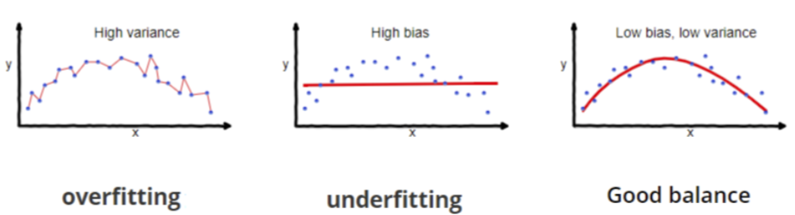
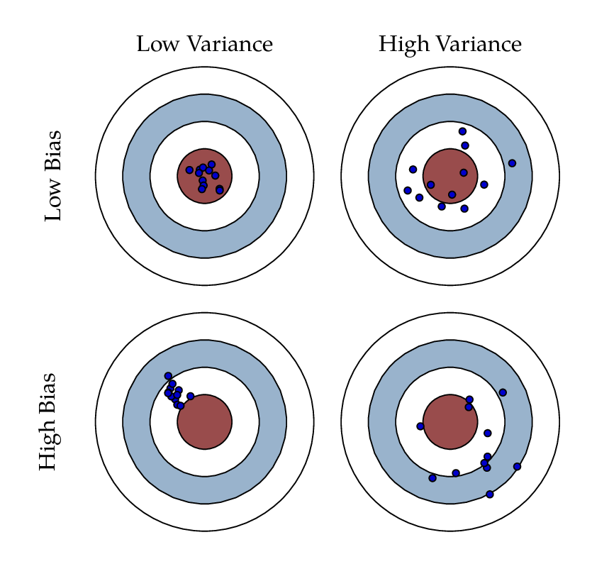
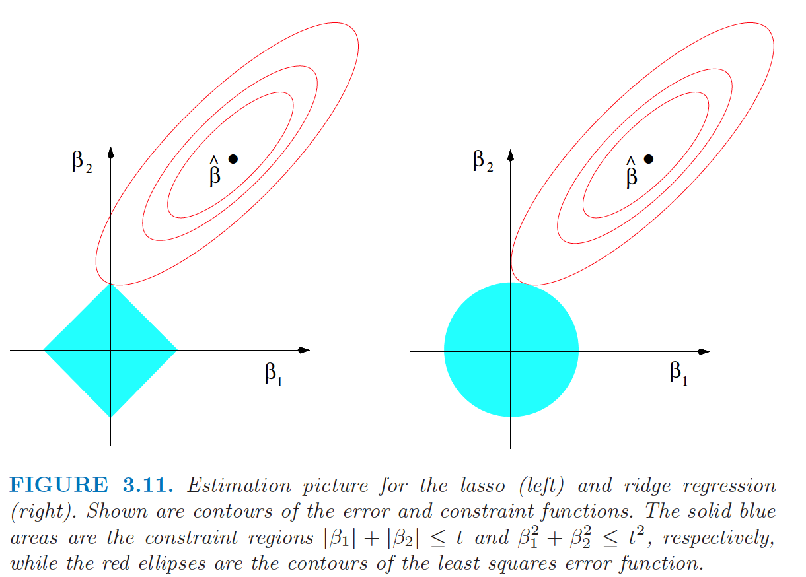
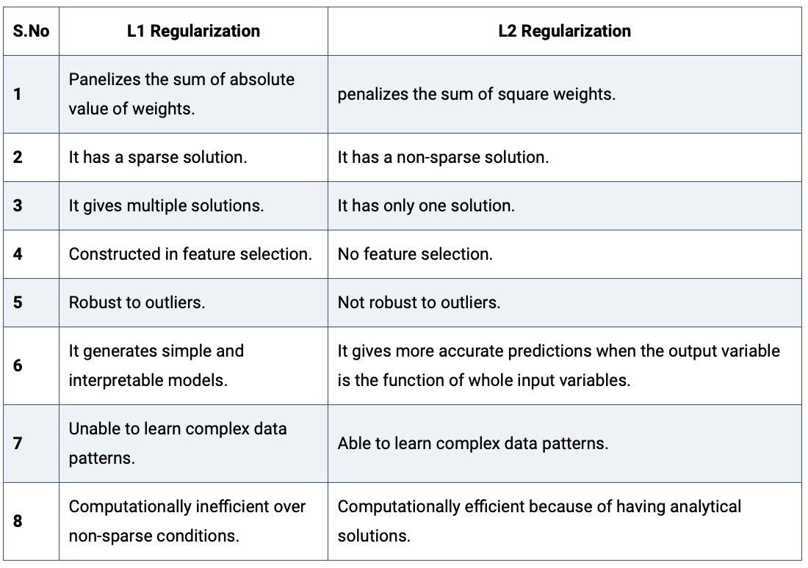

```{r setup, include=FALSE}
knitr::opts_chunk$set(echo = TRUE)
img_path <- "regfigs/"
```

## Bias-Variance tradeoff
\Large
* **Bias–variance tradeoff:** we can reduce the variance of estimates by accepting some bias
* **Bias–variance dilemma:** we can't minimize both at once, and both limit how well a model generalizes beyond its training set

(Source: Wikipedia)

## Bias-Variance tradeoff
\Large
* **Bias:** error from wrong assumptions; misses real relationships (**underfitting**)
* **Variance:** error from sensitivity to the training set; models the noise (**overfitting**)

## Bias-Variance tradeoff



## Bias-Variance tradeoff
\center
{width=50%}

## Bias-Variance tradeoff
\Large
A central problem in supervised learning. We want a model that:

* captures the patterns in the training data, **and**
* generalizes to new data

Usually we can't have both:

* High variance: fits training data well, but overfits noise
* High bias: simpler, but underfits real patterns

(Source: Wikipedia)

## Regularization in Machine Learning
\Large
* With small samples or noisy data, coefficient estimates can be inaccurate (overfitting)
* **Regularization** restricts or shrinks estimates toward zero:
  * reduces the impact of unimportant features
  * adds a little bias to cut variance and overfitting
  * improves performance on new data\footnote{Adapted from: https://www.analyticssteps.com/blogs/l2-and-l1-regularization-machine-learning}

## Regularization in Machine Learning
\Large
Examples:

* Regression: penalize coefficients for parsimonious models (variable selection)
* K-means: restrict clusters to avoid redundant groups
* Neural networks: constrain the weights
* Random forests: limit tree depth


## Ridge regression
\Large
Ridge regression **shrinks** coefficients by penalizing their size:
$$\hat\beta^{ridge}=\underset{\beta}\inf\left\{\sum_{i=1}^{N}(y_i-\sum_{j=1}^{p}x_{ij}\beta_j)^2+\lambda\sum_{j=1}^{p}\beta_j^2\right\},$$
where $\lambda\ge 0$ controls the shrinkage: larger $\lambda$, more shrinkage toward 0.


## Ridge regression
\Large
In matrix form:
$$\hat\beta^{ridge}=\underset{\beta}\inf\left\{({\bf y}-{\bf X}\beta)^T({\bf y}-{\bf X}\beta) + \lambda\beta^T\beta\right\}.$$
with closed-form solution:
$$\hat\beta^{ridge}=({\bf X}^T{\bf X}+\lambda {\bf I}_p)^{-1}{\bf X}^T{\bf y}$$

## Ridge regression
\Large
The ridge penalty $\lambda\beta^T\beta$ is an **L2 penalty** (squared size of the coefficients). SVMs use it too.

* Handles multicollinearity: shrinks coefficients but keeps all variables
* Does **not** select variables. For that, we use an **L1 penalty**.


## Ridge regression: a Bayesian perspective
\Large
The ridge penalty is equivalent to a Normal prior on $\beta$ with mean zero; $\lambda$ is inversely related to the prior variance.


## Lasso regression
\Large
Lasso (Least Absolute Shrinkage and Selection Operator) shrinks coefficients with an **L1** penalty:
$$\hat\beta^{lasso}=\underset{\beta}\inf\left\{\sum_{i=1}^{N}(y_i-\sum_{j=1}^{p}x_{ij}\beta_j)^2+\alpha\sum_{j=1}^{p}|\beta_j|\right\},$$
where $\alpha\ge 0$ controls the shrinkage: larger $\alpha$, more shrinkage toward 0.

## Lasso regression
\Large
* Same as ridge, with L2 $\sum_{j=1}^{p}\beta_j^2$ replaced by L1 $\sum_{j=1}^{p}|\beta_j|$
* No closed-form solution (nonlinear in the $y_i$)
* A large enough $\alpha$ sets some coefficients **exactly to zero**: the lasso does **variable selection**

## Lasso vs Ridge regression
\center
{width=60%}

\scriptsize
([Elements of Statistical Learning](https://hastie.su.domains/Papers/ESLII.pdf), Hastie, Tibshirani, Friedman, by Springer)


## Lasso vs Ridge regression
\center
{width=60%}

\tiny
(https://www.analyticssteps.com/blogs/l2-and-l1-regularization-machine-learning)


## Elastic net regularization
\Large
Ridge or lasso? Why choose! The **elastic net** minimizes:
$$\hat\beta^{elastic\ net}=\underset{\beta}\inf\left\{\sum_{i=1}^{N}(y_i-\sum_{j=1}^{p}x_{ij}\beta_j)^2+\alpha\sum_{j=1}^{p}|\beta_j|+\lambda\sum_{j=1}^{p}\beta_j^2\right\},$$
for $\alpha\ge 0$, $\lambda\ge 0$.

* The quadratic term makes the loss strongly convex (unique minimum)
* Special cases: ridge ($\alpha=0$), lasso ($\lambda=0$), OLS (both 0)


## Regression Regularization in R: glmnet
\Large
Regularization in R with **glmnet**:

```{r, eval=F}
install.packages("glmnet")
```

## Regression Regularization in R: glmnet
\Large
For least squares (the default), glmnet minimizes:
$$\hat\beta^{elastic\ net}=\underset{\beta}\inf\left\{\sum_{i=1}^{N}(y_i-\sum_{j=1}^{p}x_{ij}\beta_j)^2+ \lambda \left( \alpha\sum_{j=1}^{p}|\beta_j|+ (1-\alpha)\sum_{j=1}^{p}\beta_j^2 \right)  \right\},$$
with $\alpha=1$ by default (lasso!).

## Regression Regularization in R: glmnet
The package's quick start example:

```{r}
library(glmnet)
data(QuickStartExample)
x <- QuickStartExample$x
y <- QuickStartExample$y
```

## Regression Regularization in R: glmnet
\Large
The most basic call:

```{r}
fit <- glmnet(x, y)
```

`fit` holds the full fitted model. Use `plot`, `print`, `coef`, and `predict` rather than extracting components directly.

## Regression Regularization in R: glmnet
Coefficient paths:
```{r fig.height = 3, fig.width = 6, out.width="80%", fig.align="center"}
plot(fit)
```

## Regression Regularization in R: glmnet
`print` summarizes the path at each step:
\small
```{r}
print(fit)
```

## Regression Regularization in R: glmnet
Coefficients at a given $\lambda$:
```{r}
coef(fit, s = 0.1)
```

## Regression Regularization in R: glmnet
`glmnet` returns a whole sequence of models. Choose one by **cross-validation** with `cv.glmnet`:

```{r fig.height = 3, fig.width = 6, out.width="60%", fig.align="center"}
cvfit <- cv.glmnet(x, y)
plot(cvfit)
```

## Regression Regularization in R: glmnet
$\lambda_{min}$ and its coefficients:
\tiny
```{r }
cvfit$lambda.min
coef(cvfit, s = "lambda.min")
```

## Example: Logistic Regression Elastic Net
\Large
For a binary response $y \in \{0,1\}$, logistic regression models
$$P(y=1|{\bf X})=\frac{e^{{\bf X\beta}}}{1+e^{X\beta}},$$
or equivalently
$$\log\frac{P(y=1|{\bf X})}{P(y=0|{\bf X})}={\bf X}\beta,$$
the logistic (log-odds) transformation.

## Example: Logistic Regression Elastic Net
\Large
Minimize:
$$\underset{\beta}\inf\left\{-\frac{1}{N}\sum_{i=1}^N \left[y_i{\bf x}_i'\beta-\log\left(1+e^{{\bf x}_i'\beta}\right)\right]+ \lambda \left( \alpha\sum_{j=1}^{p}|\beta_j|+ (1-\alpha)\sum_{j=1}^{p}\beta_j^2 \right)\right\},$$
the logistic regression loss plus the elastic net penalty.

* Logistic regression breaks down when $p>N$ and is unstable when $N \approx p$
* The elastic net fixes this by regularizing and selecting variables

## Example: Logistic Regression Elastic Net
\Large
The glmnet binomial example:

```{r}
library(glmnet)
data(BinomialExample)
x <- BinomialExample$x
y <- BinomialExample$y
```

## Example: Logistic Regression Elastic Net
\Large
Use `family = "binomial"`:
```{r}
fit <- glmnet(x, y, family = "binomial")
```

10-fold CV with misclassification error:
```{r }
cvfit <- cv.glmnet(x, y, family = "binomial",
                   type.measure = "class")
```

## Example: Logistic Regression Elastic Net
CV results and the best $\lambda_{min}$:
```{r fig.height = 4, fig.width = 10, out.width="100%", fig.align="center"}
plot(cvfit)
cvfit$lambda.min
```

## Example: Logistic Regression Elastic Net
\tiny
```{r }
coef(cvfit, s = "lambda.min")
```

## Session Info
\tiny
```{r session}
sessionInfo()
```
