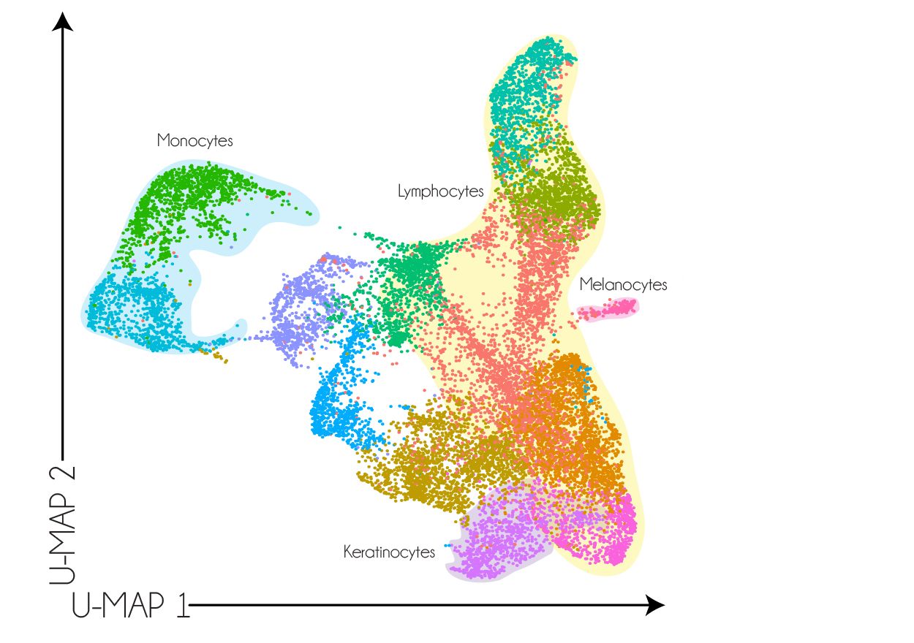

```{r setup, include=FALSE}
knitr::opts_chunk$set(echo = TRUE, message = FALSE, warning = FALSE)
library(tidyverse)
library(dslabs)
img_path <- "clusterFigs/"
```

## Learning objectives
\Large
By the end of this lecture you should be able to:

* Choose a distance and decide whether to scale features
* Run and interpret hierarchical clustering and k-means
* Pick the number of clusters, and know the limits of the tools for it
* Check clusters against known labels
* Know when to reach for GMMs, DBSCAN, or graph-based (Leiden) clustering
* Make informative heatmaps

## Supervised vs. Unsupervised Machine Learning
\Large
* **Supervised:** outcomes in the training set *supervise* the prediction algorithm
* **Unsupervised:** no outcomes; we look for groups in the data
* Unsupervised methods are often called **clustering** algorithms

## Unsupervised Machine Learning
\Large
* Clustering is not always useful: from heights alone, we may not recover males and females
* But it is a powerful **exploratory** tool, e.g., cell types in single-cell data:

\center
{width=40%}

## Look at your data first: boxplots
\Large
Gene expression for 189 samples from 7 tissues (500 genes). Boxplots show each feature's center, spread, and outliers:

\normalsize
```{r, eval=FALSE}
data("tissue_gene_expression")
dat <- data.frame(tissue = tissue_gene_expression$y,
                  tissue_gene_expression$x[, 1:4]) %>%
  pivot_longer(-tissue, names_to = "gene", values_to = "expr")
ggplot(dat, aes(tissue, expr, fill = tissue)) +
  geom_boxplot() + facet_wrap(~gene) +
  theme(axis.text.x = element_blank())
```

## Look at your data first: boxplots
```{r boxplots, echo=FALSE, out.width="80%", fig.width=8, fig.height=4.2, fig.align='center'}
data("tissue_gene_expression")
dat <- data.frame(tissue = tissue_gene_expression$y,
                  tissue_gene_expression$x[, 1:4]) %>%
  pivot_longer(-tissue, names_to = "gene", values_to = "expr")
ggplot(dat, aes(tissue, expr, fill = tissue)) +
  geom_boxplot() + facet_wrap(~gene) +
  theme(axis.text.x = element_blank())
```

## Choosing a distance
\Large
Every clustering method starts with a **distance**. The choice matters more than the algorithm:

* **Euclidean:** $\sqrt{\sum_j (x_{ij}-x_{kj})^2}$; sensitive to scale
* **Manhattan:** $\sum_j |x_{ij}-x_{kj}|$; less sensitive to outliers
* **Correlation:** $1 - r_{ik}$; similar *patterns* regardless of level. Common for gene expression

```{r, eval=FALSE}
dist(x)                        # Euclidean
dist(x, method = "manhattan")
as.dist(1 - cor(t(x)))         # correlation
```

## Should you scale?
\Large
* Features on large scales dominate Euclidean distance (e.g., age in years vs. a lab value in thousands)
* `scale(x)` gives each feature mean 0 and SD 1, so all count equally
* But scaling also amplifies **noisy, low-variance** features
* Gene expression: usually center, often scale, and filter low-variance genes first

```{r, eval=FALSE}
d <- dist(scale(x))
```

## Hierarchical clustering
\Large
1. Start with each observation as its own group
2. Merge the two closest groups
3. Recompute distances to the new group
4. Repeat until there is one group

## Hierarchical clustering: movie ratings
Ratings of the top 50 movies from users with $\ge$ 25 ratings:
\scriptsize
```{r}
data("movielens")
top <- movielens %>% group_by(movieId) %>%
  summarize(n=n(), title = first(title)) %>%
  top_n(50, n) %>% pull(movieId)

x <- movielens %>% filter(movieId %in% top) %>%
  group_by(userId) %>% filter(n() >= 25) %>%
  ungroup() %>% select(title, userId, rating) %>%
  spread(userId, rating)

row_names <- str_remove(x$title, ": Episode") %>% str_trunc(20)
x <- x[,-1] %>% as.matrix()
x <- sweep(x, 2, colMeans(x, na.rm = TRUE))
x <- sweep(x, 1, rowMeans(x, na.rm = TRUE))
rownames(x) <- row_names
```

## Missing data
\Large
`r round(100 * mean(is.na(x)))`% of the movie $\times$ user matrix is missing (users didn't rate every movie).

* `dist()` uses only the users who rated **both** movies, then rescales
* Fine for exploration, but distances rest on different numbers of raters
* Other options: impute, or filter to fewer movies/users with more overlap

## Hierarchical clustering
\Large
Compute pairwise distances between movies, then cluster:

```{r}
d <- dist(x)
h <- hclust(d)
```

## Hierarchical clustering: dendrogram
```{r dendrogram, out.width="100%", fig.width = 10, fig.height = 4.5, echo=FALSE}
par(mar = c(1, 4, 1, 1))
plot(h, cex = 0.65, main = "", xlab = "", sub = "")
```

## Reading a dendrogram
\Large
* The height where two movies first join is their distance
* The three original _Star Wars_ movies join below 8
* _Raiders of the Lost Ark_ and _Silence of the Lambs_ only join near 17

**Question:** how many groups would you cut this tree into? Why?

## Linkage: distance between groups
\Large
* **Complete** (R default): max distance between members
* **Single:** min distance (tends to "chain")
* **Average:** mean distance
* **Ward's:** merge that least increases within-group variance

```{r, eval=FALSE}
hclust(d, method = "ward.D2")
```

## Cutting the tree
Either 1) set a maximum distance, or 2) set the number of groups:

```{r, out.width="100%", fig.width = 10, fig.height = 4.5, echo=FALSE}
par(mar = c(1, 4, 1, 1))
plot(h, cex = 0.65, main = "", xlab = "", sub = "")
abline(h=14,col=2)
```

## Cutting the tree
`cutree` does either:
\small
```{r}
groups <- cutree(h, h = 14)  # maximum distance
table(groups)
groups <- cutree(h, k = 10)  # number of groups
table(groups)
```

## Interpreting groups
Group numbers are arbitrary, so find groups by a member:
\scriptsize
```{r}
in_group <- function(g, title) names(g)[g == g[title]]
in_group(groups, "Star Wars IV - A ...")
in_group(groups, "Schindler's List")
in_group(groups, "Ace Ventura: Pet ...")
```

\normalsize
Sci-fi/fantasy franchises, prestige dramas, and Jim Carrey comedies.

## Hierarchical clustering: raters
We can also cluster the raters (columns):

```{r dendrogram-2, out.width="100%", fig.height=4, fig.width=10}
h_2 <- dist(t(x)) %>% hclust()
plot(h_2, cex = 0.35, main = "", xlab = "", sub = "")
```

## K-means
\Large
Pre-specify $k$ clusters, then iterate:

1. **Assign** each observation to the closest center
2. **Update** each center to the mean (**centroid**) of its cluster
3. Repeat until the centers stop changing

## K-means: objective function
\Large
Minimize the **within-cluster sum of squares (WCSS)**:

$$
\min_{S} \sum_{k=1}^{K} \sum_{\mathbf{x}_i \in S_k} || \mathbf{x}_i - \boldsymbol{\mu}_k ||^2
$$

* $S_k$: observations in cluster $k$
* $\boldsymbol{\mu}_k$: centroid of cluster $k$

## K-means: convergence
\Large
* Each step **decreases** the WCSS, so k-means always converges
* But only to a **local** minimum, which depends on the starting centers
* Fixes:
  * Many random starts (`nstart` in R) and keep the lowest WCSS
  * **k-means++** to choose better starting centers
* Assumes roughly round, similar-sized clusters

## K-means in R
`kmeans` does not handle NAs. We fill them with 0, which (after centering) means **mean imputation**: an unrated movie gets the user's average.
\small
```{r}
x_0 <- x; x_0[is.na(x_0)] <- 0
set.seed(0)
k <- kmeans(x_0, centers = 10, nstart = 25)
groups <- k$cluster
table(groups)
```

## K-means: groups
\scriptsize
```{r}
in_group(groups, "Star Wars IV - A ...")
in_group(groups, "Schindler's List")
in_group(groups, "Pulp Fiction")
```

## Choosing $k$
\Large
No single right answer. Common tools:

* **Elbow plot:** WCSS vs. $k$; look for a bend
* **Silhouette width:** how much closer each point is to its own cluster than to the next one ($-1$ to $1$; higher is better)
* **Gap statistic:** WCSS compared with data that have no clusters

We'll try all three on the tissue data, where we know there are 7 tissues.

## Choosing $k$: tissue data
\small
```{r choose-k, fig.show='hide'}
library(cluster)
xt <- sweep(tissue_gene_expression$x, 2, colMeans(tissue_gene_expression$x))
set.seed(1)
wcss <- sapply(1:12, function(k) kmeans(xt, k, nstart = 20)$tot.withinss)
sil  <- sapply(2:12, function(k)
  mean(silhouette(kmeans(xt, k, nstart = 20)$cluster, dist(xt))[, 3]))
gap  <- clusGap(xt, kmeans, K.max = 12, B = 20, nstart = 10)
par(mfrow = c(1, 3))
plot(1:12, wcss, type = "b", xlab = "k", main = "Elbow (WCSS)")
plot(2:12, sil,  type = "b", xlab = "k", main = "Mean silhouette")
plot(gap, main = "Gap statistic", xlab = "k")
```

## Choosing $k$: tissue data
```{r choose-k-plot, echo=FALSE, out.width="95%", fig.width=11, fig.height=3.6, fig.align='center'}
par(mfrow = c(1, 3))
plot(1:12, wcss, type = "b", xlab = "k", main = "Elbow (WCSS)")
plot(2:12, sil,  type = "b", xlab = "k", main = "Mean silhouette")
plot(gap, main = "Gap statistic", xlab = "k")
```

## Choosing $k$: lessons
\Large
* The elbow is gradual; silhouette peaks at $k = 11$; the gap statistic picks $k = 8$. The truth is 7
* The criteria often **disagree**, and none knows the biology
* Real tissues contain sub-types, so "extra" clusters may be real
* Use these as guides, then check clusters against what you know

## Checking clusters against known labels
\Large
Cross-tabulate clusters with the truth, and summarize with the **adjusted Rand index** (ARI: 1 = perfect agreement, 0 = chance):

\scriptsize
```{r}
set.seed(1)
km <- kmeans(xt, centers = 7, nstart = 25)$cluster
table(cluster = km, tissue = tissue_gene_expression$y)
```

## Checking clusters against known labels
\large
```{r}
mclust::adjustedRandIndex(km, tissue_gene_expression$y)
```

* Colon, endometrium, kidney, liver, and placenta each get a clean cluster
* 5 cerebellum samples cluster with hippocampus (both brain)
* Agreement is high but not perfect, and k-means needed us to say $k = 7$
* Unsupervised methods find **structure**, which may not match your labels

## Other Clustering Methods
\normalsize
\begin{tabular}{|l|l|p{6cm}|}
\hline
\textbf{Algorithm} & \textbf{Class} & \textbf{Key Features} \\
\hline
\hline
\textbf{Mixture model (GMM)} & Model-based & Mixture of $K$ distributions; \textbf{soft} assignments; fit with \textbf{EM} \\
\hline
\textbf{DBSCAN} & Density-based & Arbitrary shapes; flags \textbf{outliers}; no $K$ needed \\
\hline
\textbf{Louvain / Leiden} & Graph-based & \textbf{Communities} in large networks by maximizing \textbf{modularity} \\
\hline
\textbf{Affinity propagation} & Message passing & Picks "exemplars" as centers; no $K$ needed \\
\hline
\end{tabular}

## Gaussian mixture models
\Large
* Each cluster is a multivariate normal with its own mean and covariance
* Clusters can be **elliptical** and different sizes
* **Soft** assignment: each point gets a probability for each cluster
* `mclust` picks the number of clusters and covariance shape by **BIC**

## Gaussian mixture models: Old Faithful
\small
```{r gmm, out.width="45%", fig.width=5, fig.height=4, fig.align='center'}
library(mclust)
fit <- Mclust(faithful)          # eruption length vs. waiting time
summary(fit)$G                   # clusters chosen by BIC
plot(fit, what = "classification")
```

## Gaussian mixture models: uncertainty
\Large
Soft assignments flag the points we are unsure about:

\normalsize
```{r}
round(head(fit$z), 3)            # P(cluster | data) for each point
sum(fit$uncertainty > 0.1)       # points with >10% uncertainty
```

## DBSCAN: density-based clustering
\Large
* A **core point** has at least `minPts` neighbors within radius `eps`
* Clusters grow by connecting core points; isolated points are **noise**
* Finds non-round shapes, and doesn't need $k$

## DBSCAN vs. k-means
\small
```{r dbscan, fig.show='hide'}
library(dbscan)
set.seed(2)
t <- runif(300, 0, pi)
moons <- rbind(cbind(cos(t), sin(t)),
               cbind(1 - cos(t), 0.5 - sin(t))) +
  matrix(rnorm(1200, sd = 0.08), ncol = 2)
km <- kmeans(moons, 2, nstart = 10)$cluster
db <- dbscan(moons, eps = 0.2, minPts = 5)$cluster   # 0 = noise
par(mfrow = c(1, 2))
plot(moons, col = km + 1, pch = 19, main = "k-means")
plot(moons, col = db + 1, pch = 19, main = "DBSCAN")
```

## DBSCAN vs. k-means
```{r dbscan-plot, echo=FALSE, out.width="80%", fig.width=9, fig.height=4, fig.align='center'}
par(mfrow = c(1, 2))
plot(moons, col = km + 1, pch = 19, main = "k-means")
plot(moons, col = db + 1, pch = 19, main = "DBSCAN (black = noise)")
```

## Graph-based clustering: modularity
\large
Standard for single-cell data (Seurat, Scanpy). Build a **nearest-neighbor graph**, then find communities that maximize **modularity**:

$$
\mathcal{Q} = \frac{1}{2m} \sum_{i,j} \left[ A_{ij} - \frac{k_i k_j}{2m} \right] \delta(c_i, c_j)
$$

* $A_{ij}$: edge weight between nodes $i$ and $j$; $m$: total edge weight
* $k_i$: degree of node $i$; $\delta(c_i, c_j)=1$ if same community

High $\mathcal{Q}$: dense connections within communities, sparse between.

## Louvain and Leiden algorithms
\Large
**Louvain** (greedy; repeat until $\mathcal{Q}$ stops improving):

1. **Optimize:** move each node to the neighbor community with the largest gain in $\mathcal{Q}$
2. **Aggregate:** collapse each community into a single node; repeat

**Leiden** (Traag et al., 2019) adds a refinement step that guarantees connected communities. Now the default in Seurat and Scanpy.

## Leiden clustering in R
\small
```{r leiden}
library(igraph); library(FNN)
pcs <- prcomp(xt)$x[, 1:20]                 # work in PC space
nn  <- get.knn(pcs, k = 10)$nn.index        # 10 nearest neighbors
g   <- graph_from_edgelist(cbind(rep(1:nrow(pcs), 10), as.vector(nn)),
                           directed = FALSE) %>% simplify()
set.seed(1)
cl  <- membership(cluster_leiden(g, objective_function = "modularity",
                                 n_iterations = -1))
```

## Leiden clustering: results
\scriptsize
```{r}
table(cluster = cl, tissue = tissue_gene_expression$y)
mclust::adjustedRandIndex(cl, tissue_gene_expression$y)
```

## Leiden clustering: lessons
\Large

* We never chose $k$: the **resolution** parameter controls how many communities
* Kidney splits in two, and placenta joins colon: more communities is not always better
* We'll use this again in the single-cell example next lecture

## Heatmaps
\Large
* Plot the data matrix as colors
* Order rows and columns by hierarchical clustering

\normalsize
```{r}
x <- xt                                  # centered tissue data
h_1 <- hclust(dist(x))
h_2 <- hclust(dist(t(x)))
```

## Heatmaps
```{r heatmap, out.width="45%", fig.height=7, fig.align='center'}
image(x[h_1$order, h_2$order])
```

## Heatmaps: `pheatmap`
`pheatmap` adds annotations and a legend. Note `scale`: base R's `heatmap()` rescales each **row** by default; be explicit.
\scriptsize
```{r heatmap-2, fig.show='hide'}
library(pheatmap)
ann <- data.frame(tissue = tissue_gene_expression$y, row.names = rownames(x))
pheatmap(x, scale = "none", annotation_row = ann, show_rownames = FALSE,
         show_colnames = FALSE, color = rev(RColorBrewer::brewer.pal(11, "RdBu")))
```

## Heatmaps: `pheatmap`
```{r heatmap-2b, echo=FALSE, out.width="45%", fig.height=6, fig.width=7, fig.align='center'}
pheatmap(x, scale = "none", annotation_row = ann, show_rownames = FALSE,
         show_colnames = FALSE, color = rev(RColorBrewer::brewer.pal(11, "RdBu")))
```

## Filtering features
\Large
* Uninformative features add noise and hide clusters
* Simple fix: keep the **highest-variance** features

\normalsize
```{r, eval=FALSE}
library(matrixStats)
o <- order(colSds(x), decreasing = TRUE)[1:25]
pheatmap(x[, o], scale = "none", annotation_row = ann,
         show_rownames = FALSE,
         color = rev(RColorBrewer::brewer.pal(11, "RdBu")))
```

## Filtering features
```{r heatmap-3, echo=F, out.width="45%", fig.height=6, fig.width=7, fig.align='center'}
library(matrixStats)
o <- order(colSds(x), decreasing = TRUE)[1:25]
pheatmap(x[, o], scale = "none", annotation_row = ann, show_rownames = FALSE,
         color = rev(RColorBrewer::brewer.pal(11, "RdBu")))
```

## Summary
\Large
* Distance and scaling choices drive the results; decide them on purpose
* Hierarchical: no $k$ up front, gives a tree; k-means: fast, needs $k$, round clusters
* Choosing $k$: elbow, silhouette, gap are guides, not answers
* Validate: compare with known labels (table, ARI) and biology
* GMM (soft, elliptical), DBSCAN (shapes, noise), Leiden (graphs, single-cell)
* Heatmaps: annotate, and be explicit about scaling

## Python companion
\Large
Python versions of these examples (`scikit-learn`, `scipy`, `seaborn`, `igraph`):

`python/week4/clustering.ipynb`

## Session Info
\tiny
```{r session}
sessionInfo()
```
