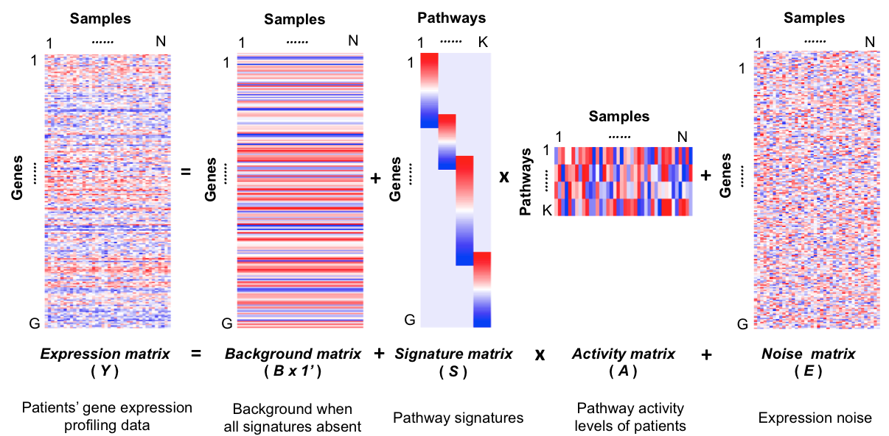
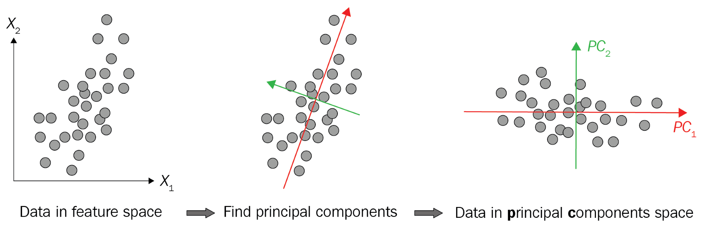
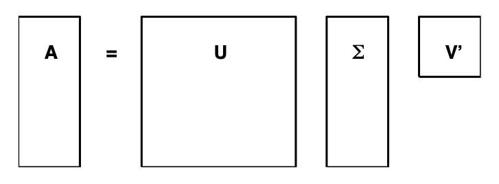
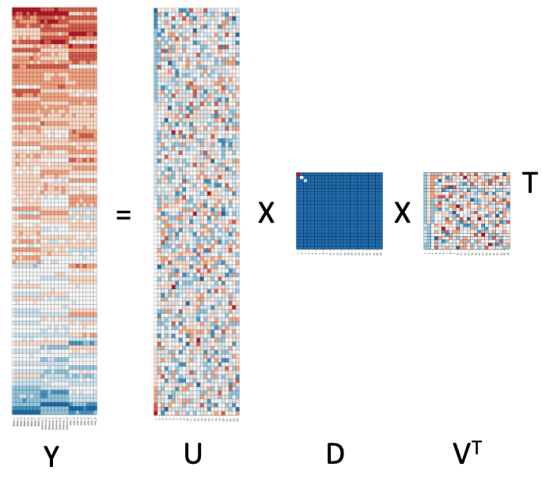
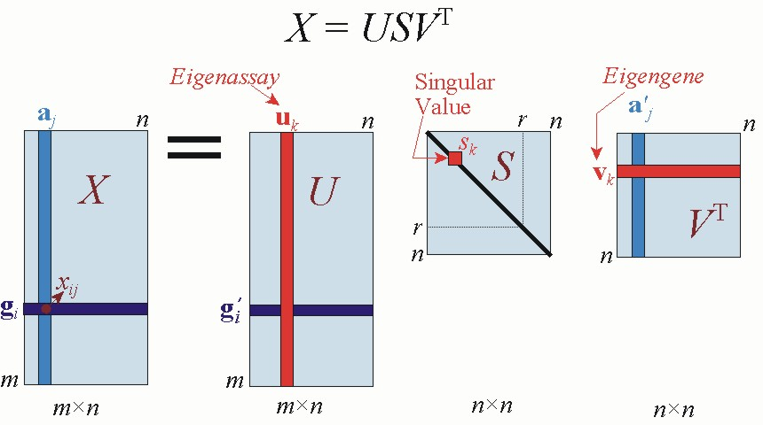
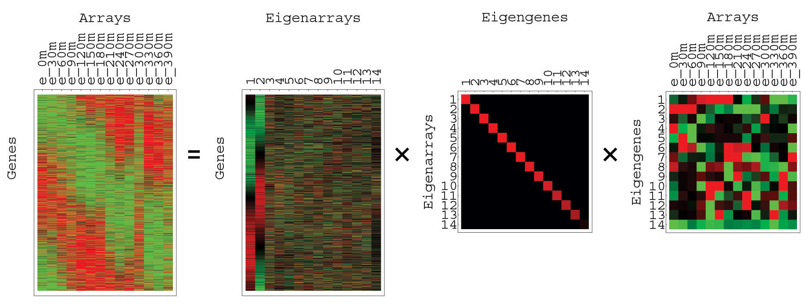

```{r setup, include=FALSE}
knitr::opts_chunk$set(echo = TRUE, message = FALSE, warning = FALSE)
library(tidyverse)
library(Rtsne)
library(uwot)
img_path <- "dimRedfigs/"
```

## Learning objectives
\Large
By the end of this lecture you should be able to:

* Explain PCA as a rotation that concentrates variance
* Choose how many PCs to keep, read loadings, and decide whether to scale
* Connect PCA, eigendecomposition, and the SVD
* Use PCA to spot **batch effects**
* Apply NMF, t-SNE, and UMAP, and know their pitfalls
* Run a basic single-cell workflow: PCA $\rightarrow$ graph clustering $\rightarrow$ UMAP

## Dimension reduction
\Large
* Biomedical data often have many predictors (genes, taxa, proteins)
* Hard to visualize relationships in high dimensions
* **Dimension reduction:** fewer dimensions, while preserving key features such as distances between observations

## Dimension reduction: motivation
Microbiome 16S data example:

```{r, eval=F}
library(animalcules)
run_animalcules()
```

\center
{width=65%}

## Dimension reduction
\Large
* The engine behind it all: the **singular value decomposition (SVD)**
* We start with **principal component analysis (PCA)**
* First, a simple example to build intuition

## Dimension reduction: twin heights
Simulated heights for 100 pairs of twins (children and adults):

```{r}
set.seed(1988)
library(MASS)
n <- 100
Sigma <- matrix(c(9, 9 * 0.9, 9 * 0.92, 9 * 1), 2, 2)
x <- rbind(mvrnorm(n / 2, c(69, 69), Sigma),
           mvrnorm(n / 2, c(55, 55), Sigma))
```

## Dimension reduction: twin heights
\Large
Highly correlated, with two groups (adults and children):

```{r distance-illustration, fig.width=3, fig.height=3, echo=FALSE, out.width="40%", fig.align='center'}
lim <- c(48, 78)
par(mar = c(4, 4, 1, 1))
plot(x, xlim=lim, ylim=lim, xlab='Twin 2', ylab='Twin 1')
points(x[c(1, 2, 51),], pch = 16)
```

## Dimension reduction: twin heights
\Large
* Pretend 2 dimensions is too many: can we reduce to 1 and still see the 2 groups?
* Distances between points mostly run along the diagonal
* Try the **average** and the **difference**:

```{r}
z  <- cbind(average=(x[,2] + x[,1])/2,
            difference=x[,2] - x[,1])
```

## Dimension reduction: twin heights
Most of the distance is explained by the first dimension, the average:

```{r rotation, fig.width=3, fig.height=3, echo=FALSE, out.width="40%", fig.align='center'}
par(mar = c(4, 4, 1, 1))
plot(z, xlim=lim, ylim = lim - mean(lim))
points(z[c(1,2,51),], pch = 16)
```

## Linear transformations
\Large
We applied a linear transformation to each row:

$$Z_{i,1} = \tfrac{1}{2} X_{i,1} + \tfrac{1}{2} X_{i,2}, \qquad Z_{i,2} = X_{i,1} - X_{i,2}$$

In matrix form:
$$
Z = X A
\mbox{ with }
A = \,
\begin{pmatrix}
1/2&1\\
1/2&-1\\
\end{pmatrix}
$$

## Linear transformations
And we can transform back with $X = Z A^{-1}$:

```{r}
A <- matrix(c(1/2,1/2,1,-1), nrow=2)
z <- x %*% A
x_back <- z %*% solve(A)
max(abs(x - x_back))
```

\Large
**Dimension reduction:** find $A$ that *rotates* the information in $X$ into the first few columns of $Z = XA$, then keep only those columns.

## Principal component analysis


## Principal component analysis
\Large
* The **first principal component (PC)** is the orthogonal linear transformation of $X$ with maximum variance
* Each next PC has maximum variance, orthogonal to the previous ones

```{r}
pca <- prcomp(x)
pca$rotation
```

## Principal component analysis
\Large
* PC1 is (almost) the average; PC2 is (almost) the difference
* `$rotation`: the transformation $A$ (**loadings**)
* `$x`: the transformed data $Z$ (**PC scores**)

\normalsize
```{r}
head(cbind(z, pca$x), 3)
```

## Principal component analysis
```{r illustrate-pca-twin-heights, echo=FALSE, out.width="50%", fig.align='center'}
illustrate_pca <- function(x, flip=1,
                           pad = round((nrow(x)/2-ncol(x))*1/4),
                           cex = 5, center = TRUE){
  par(mfrow = c(1, 5), mar = c(1, 1, 2, 1))
  colors = rev(RColorBrewer::brewer.pal(9, "RdBu"))
  pca <- prcomp(x, center = center)
  if(center) z <- t(x) - rowMeans(t(x))
  cols <- 1:ncol(x)
  rows <- 1:nrow(x)
  image(cols, rows, z[,rev(1:ncol(z))], xaxt = "n", yaxt = "n",
        xlab="", ylab="", main= "X", col = colors)
  abline(v = cols + 0.5)
  plot.new(); text(0.5, 0.5, "=", cex = cex)
  z <- flip*t(pca$x)
  image(cols, rows, z[,rev(1:ncol(z))], xaxt = "n", yaxt = "n",
        xlab="", ylab="", main= "Weights", col = colors)
  abline(v = cols + 0.5)
  plot.new(); text(0.5, 0.5, "x", cex = cex)
  z <- flip*pca$rotation
  nz <- cbind(matrix(NA, ncol(z), pad), z, matrix(NA, ncol(z), pad))
  rows <- 1:ncol(nz)
  image(cols, rows, nz[,rev(1:ncol(nz))],  xaxt = "n", yaxt = "n",
        bty = "n", xlab="", ylab="", col = colors)
  abline(h = pad+0:ncol(z)+1/2)
  lines(c(ncol(z)/2+0.5,ncol(z)/2+1/2),c(pad,pad+ncol(z))+0.5)
  text(ncol(z)/2+0.5, pad+ncol(z)+2 , expression(bold(Pattern^T)), font=2)
}
illustrate_pca(x, flip = -1)
```

## Principal component analysis
\Large
* Works for any number of columns $p$
* If the PCs after the first $k$ have tiny variance, $k$ dimensions approximate the distances well
* If $k \ll p$: an efficient **reduction** of the data

## Iris example
Four flower measurements for three species:
\small
```{r}
head(iris)
```

## Iris example
Distances between flowers: one species is very different from the other two
\small
```{r iris-distances, fig.width = 4, fig.height = 4, out.width="38%", fig.align='center'}
x <- iris[,1:4] %>% as.matrix()
d <- dist(x)
cols <- rev(RColorBrewer::brewer.pal(9, "RdBu"))
image(as.matrix(d), col = cols)
```

## Iris example
Three of the four features are highly correlated:
\small
```{r}
cor(x)
```

\Large
So PCA should capture these distances in about two dimensions.

## Iris example
```{r}
pca <- prcomp(x)
summary(pca)
```

\Large
The first two PCs explain 97% of the variance.

## Iris example
```{r illustrate-pca-iris, echo=FALSE, fig.height = 6, out.width="50%", fig.align='center'}
illustrate_pca(x)
```

## Iris example: PC1 vs. PC2
\small
```{r iris-pca, out.width="55%", fig.height=4, fig.width=6, fig.align='center'}
data.frame(pca$x[,1:2], Species=iris$Species) %>%
  ggplot(aes(PC1, PC2, fill = Species)) +
  geom_point(cex=3, pch=21) + coord_fixed(ratio = 1)
```

## How many PCs? The scree plot
\Large
Plot the variance explained by each PC and look for where it levels off:
\normalsize
```{r scree, out.width="45%", fig.width=5, fig.height=3.5, fig.align='center'}
pve <- pca$sdev^2 / sum(pca$sdev^2)
plot(pve, type = "b", xlab = "PC", ylab = "Proportion of variance")
```

## Loadings: what drives each PC?
\Large
The **loadings** (rotation) show how much each feature contributes to each PC:
\normalsize
```{r}
round(pca$rotation[, 1:2], 2)
```

\Large
PC1 is mostly petal length; PC2 is mostly sepal size (length and width).

## Loadings: the biplot
```{r biplot, out.width="50%", fig.width=6, fig.height=5, fig.align='center'}
biplot(pca, xlabs = rep("·", nrow(x)), cex = 0.9)
```

## Should you scale before PCA?
\large
* **Covariance** PCA (default): high-variance features dominate
* **Correlation** PCA (`scale. = TRUE`): every feature counts equally
* Units matter! Petal length in millimeters instead of centimeters:

\small
```{r}
x_mm <- x; x_mm[, "Petal.Length"] <- 10 * x_mm[, "Petal.Length"]
round(prcomp(x_mm)$rotation[, 1], 2)
round(prcomp(x_mm, scale. = TRUE)$rotation[, 1], 2)
```

## Eigenvectors and eigenvalues
\Large
For a square matrix ${\bf A}$, an **eigenvalue** $\lambda$ and **eigenvector** ${\bf x}\ne 0$ satisfy
$${\bf Ax} = \lambda{\bf x}$$

* Equivalently, $\det({\bf A}-\lambda{\bf I}) = 0$ (the **characteristic equation**)
* *Eigen-* is German for "own" or "characteristic"

## Eigenvalue decomposition
\Large
Put the eigenvalues on the diagonal of $\Lambda$ and the eigenvectors in the columns of ${\bf Q}$. Then ${\bf AQ} = {\bf Q}\Lambda$, and if ${\bf Q}$ is invertible:
$${\bf A} = {\bf Q}\Lambda {\bf Q}^{-1}$$

Example: matrix powers become scalar powers, ${\bf A}^p = {\bf Q}\Lambda^p{\bf Q}^{-1}$.

## Eigenvectors and PCA
\Large
PCA of an $N\times p$ data matrix ${\bf Y}$ is the eigendecomposition of its **covariance matrix**. A covariance matrix is symmetric, so ${\bf Q}$ is orthogonal (${\bf Q}^{-1} = {\bf Q}^\top$):
$$Cov( {\bf Y} ) =  {\bf Q}\Lambda{\bf Q}^{\top}$$

* Eigenvectors (columns of ${\bf Q}$): the **loadings** (rotation)
* Eigenvalues: the **variance** explained by each PC
* Applying the rotation to ${\bf Y}$ gives the **PC scores**

## Singular value decomposition
\Large
The **SVD** factors ${\bf Y}$ directly (no covariance matrix needed). For an $N\times p$ matrix with $p < N$:
$$ Y = U D V^{\top} $$

* $U$ ($N\times p$) and $V$ ($p\times p$) are **orthogonal**
* $D$ is **diagonal**, with $d_{1,1} \geq d_{2,2} \geq \dots \geq d_{p,p}$

## Singular value decomposition


## SVD example: test scores
Scores for 100 students on 24 tests (0 = average, +25 = A, -25 = F):
\small
```{r}
set.seed(1987)
n <- 100
k <- 8
Sigma <- 64  * matrix(c(1, .75, .5, .75, 1, .5, .5, .5, 1), 3, 3)
m <- MASS::mvrnorm(n, rep(0, 3), Sigma)
m <- m[order(rowMeans(m), decreasing = TRUE),]
y <- m %x% matrix(rep(1, k), nrow = 1) +
  matrix(rnorm(matrix(n * k * 3)), n, k * 3)
colnames(y) <- c(paste(rep("Math",k), 1:k, sep="_"),
  paste(rep("Science",k), 1:k, sep="_"), paste(rep("Arts",k), 1:k, sep="_"))
```

## SVD example: test scores
\Large
Are all students about equally good? Does doing well in one subject predict another?

```{r, echo=FALSE, fig.align='center', out.width="40%"}
my_image <- function(x, zlim = range(x), ...){
  colors = rev(RColorBrewer::brewer.pal(9, "RdBu"))
  cols <- 1:ncol(x)
  rows <- 1:nrow(x)
  image(cols, rows, t(x[rev(rows),,drop=FALSE]), xaxt = "n", yaxt = "n",
        xlab="", ylab="",  col = colors, zlim = zlim, ...)
  if (nrow(x) <= 30) abline(h = rows + 0.5)
  abline(v = cols + 0.5, col = "grey60")
  axis(side = 1, cols, colnames(x), las = 2)
}
par(mar = c(6, 1, 1, 1))
my_image(y)
```

## SVD example: test scores
\Large
How would you describe the data?

a. The test scores are all independent of each other.
b. Students who test well are at the top, and there seem to be three groupings by subject.
c. Students good at math are not good at science.
d. Students good at math are not good at the arts.

## SVD example: correlations
```{r, echo=FALSE, fig.align='center', out.width="45%"}
par(mar = c(6, 6, 1, 1))
my_image(cor(y), zlim = c(-1,1))
axis(side = 2, 1:ncol(y), rev(colnames(y)), las = 2)
```

## SVD example: correlations
\Large
Which best describes what you see?

a. The test scores are independent.
b. Math and science are highly correlated, but the arts are not.
c. High correlation within a subject, none across subjects.
d. All tests are correlated, more so for math and science, and most within each subject.

## SVD in R
\large
`svd` returns $U$, $V$, and the diagonal of $D$:

```{r}
s <- svd(y)
names(s)
dim(s$u); dim(s$v); length(s$d)
```

## SVD in R
\Large
Check that we recover $Y$:

```{r}
y_svd <- s$u %*% diag(s$d) %*% t(s$v)
max(abs(y - y_svd))
```

## Visualizing the SVD: $Y$ and $U$
```{r, echo=FALSE, fig.align='center', out.width="70%", fig.width=10, fig.height=5}
par(mfrow = c(1, 2), mar = c(6, 1, 2, 1))
my_image(y, main = "Y")
my_image(s$u, main = "U")
```

## Visualizing the SVD: $D$ and $V$
```{r, echo=FALSE, fig.align='center', out.width="70%", fig.width=10, fig.height=5}
par(mfrow = c(1, 2), mar = c(4, 4, 2, 1))
barplot(s$d, names.arg = 1:length(s$d), main = "D (singular values)", xlab = "component")
par(mar = c(2, 1, 2, 1))
my_image(s$v, main = "V")
```

## Variance explained
\Large
$d_j^2$ is proportional to the variance explained by component $j$:
\normalsize
```{r}
round(s$d^2/sum(s$d^2), 3)[1:6]
round(cumsum(s$d^2)/sum(s$d^2), 3)[1:6]
```

\Large
Three components (math, science, arts) explain almost all of the variance.

## PCA and the SVD are the same thing
\Large
For **column-centered** $Y$ with SVD $Y = UDV^\top$:

* Loadings (`$rotation`) $= V$
* PC scores (`$x`) $= UD$
* PC variances $= d_j^2/(N-1)$

\normalsize
```{r}
yc <- scale(y, center = TRUE, scale = FALSE)
s_c <- svd(yc); p_y <- prcomp(y)
# equal up to sign:
max(abs(abs(p_y$x) - abs(s_c$u %*% diag(s_c$d))))
```

`prcomp` actually computes the SVD; it never forms the covariance matrix.

## Putting it together
\center
{width=40%}

## Singular value decomposition
\center
{width=80%}

## SVD of gene expression: "eigengenes"


## Batch effects
\Large
* **Batch effects:** technical variation from processing date, lab, reagent lot, or platform
* Often the **largest** source of variation in omics data
* Can hide biology, or create false findings if confounded with the outcome
* PCA is the first diagnostic: color the PC plot by batch

## Batch effects: bladder cancer data
57 bladder samples (normal, cancer, biopsy) processed in 5 batches (`bladderbatch`, Bioconductor):
\small
```{r bladder, fig.show='hide'}
library(bladderbatch); library(sva)
data(bladderdata)
e  <- exprs(bladderEset); pd <- pData(bladderEset)
top <- order(apply(e, 1, var), decreasing = TRUE)[1:2000]
pc_plot <- function(m, main) {
  p <- prcomp(t(m[top, ]))
  data.frame(p$x[, 1:2], batch = factor(pd$batch), cancer = pd$cancer) %>%
    ggplot(aes(PC1, PC2, color = batch, shape = cancer)) +
    geom_point(size = 3) + ggtitle(main)
}
pc_plot(e, "Before correction")
```

## Batch effects: bladder cancer data
```{r bladder-plot, echo=FALSE, out.width="60%", fig.width=6.5, fig.height=4.2, fig.align='center'}
pc_plot(e, "Before correction")
```

\Large
Samples group by batch as much as by cancer status.

## Batch correction with ComBat
\Large
**ComBat** (Johnson, Li & Rabinovic, 2007) removes batch-specific location and scale shifts, borrowing strength across genes (empirical Bayes). Protect the biology with `mod`:

\normalsize
```{r combat, results='hide'}
mod <- model.matrix(~ cancer, data = pd)
e_cb <- ComBat(dat = e, batch = pd$batch, mod = mod)
```

\Large
For RNA-seq counts, use **ComBat-seq** (`sva::ComBat_seq`).

## Batch correction with ComBat
```{r combat-plot, echo=FALSE, out.width="85%", fig.width=11, fig.height=4.2, fig.align='center'}
gridExtra::grid.arrange(pc_plot(e, "Before ComBat"), pc_plot(e_cb, "After ComBat"), ncol = 2)
```

## Non-negative matrix factorization (NMF)
\Large
Like SVD, a linear factorization, but **all entries non-negative**:
$$\mathbf{X} \approx \mathbf{W} \mathbf{H}$$

* $\mathbf{X}$: $N \times P$ data
* $\mathbf{W}$: $N \times K$ (basis / sample weights)
* $\mathbf{H}$: $K \times P$ (components / feature loadings)

## NMF: interpretation
\Large
* **Additive, parts-based:** components only add, never cancel
* PCA/SVD components mix positive and negative values ("holistic")
* Natural for non-negative data: counts, intensities, expression levels

## NMF: fitting
\Large
Minimize a loss, e.g.:

* **Frobenius norm:** $\frac{1}{2} \sum_{i,j} (X_{ij} - (WH)_{ij})^2$
* **KL divergence:** for count data (Poisson likelihood)

Non-convex: results depend on the starting values, so run it several times (`nrun`) and keep the best.

## NMF: multiplicative updates
\Large
Lee & Seung (2001): multiply instead of subtract, so entries stay non-negative:

$$H_{a\mu} \leftarrow H_{a\mu} \frac{(\mathbf{W}^T \mathbf{X})_{a\mu}}{(\mathbf{W}^T \mathbf{WH})_{a\mu}}
\qquad
W_{i\alpha} \leftarrow W_{i\alpha} \frac{(\mathbf{X} \mathbf{H}^T)_{i\alpha}}{(\mathbf{WH} \mathbf{H}^T)_{i\alpha}}$$

The loss never increases, so the algorithm converges.

## When to use NMF
\Large
* Data must be **non-negative**
* You want **interpretable, additive parts**. Examples:
  * **Topic modeling:** word counts $\rightarrow$ topics
  * **Images:** faces $\rightarrow$ eyes, nose, mouth
  * **Gene expression:** gene signatures, mutational signatures

## NMF: iris example
```{r iris-nmf, fig.show='hide'}
library(NMF)
set.seed(42)
nmf_res <- nmf(as.matrix(iris[, 1:4]), 2, nrun = 20)
W <- basis(nmf_res); colnames(W) <- c("NMF1", "NMF2")
data.frame(W, Species = iris$Species) %>%
  ggplot(aes(NMF1, NMF2, fill = Species)) +
  geom_point(cex = 3, pch = 21)
```

## NMF: iris example
```{r iris-nmf-plot, echo=FALSE, fig.height=4, fig.width=6, out.width='60%', fig.align='center'}
data.frame(W, Species = iris$Species) %>%
  ggplot(aes(NMF1, NMF2, fill = Species)) + geom_point(cex = 3, pch = 21)
```

## NMF: iris example
\Large
* Setosa separates, driven mostly by one component
* All points lie in the positive quadrant (additive decomposition)
* `coef(nmf_res)` gives $\mathbf{H}$: how each feature loads on each component

\normalsize
```{r}
round(coef(nmf_res), 2)
```

## Non-linear methods: t-SNE and UMAP
\Large
* PCA, SVD, and NMF are **linear**
* Real data often lie on curved, **non-linear** structures
* **t-SNE** and **UMAP** preserve **local neighborhoods**: points close in high dimensions stay close in 2D
* Standard for single-cell data visualization

## t-SNE
\Large
**t-distributed Stochastic Neighbor Embedding** (van der Maaten & Hinton, 2008):

1. Convert high-dimensional distances to neighbor probabilities
2. Find 2D points whose neighbor probabilities (t-distribution) match
3. Minimize the KL divergence between the two

Key setting: **perplexity** ($\approx$ number of neighbors, typically 5-50)

## t-SNE: iris example
\small
```{r iris-tsne, fig.show='hide'}
library(Rtsne)
set.seed(1)
iris_u <- unique(iris)   # Rtsne requires no duplicate rows
tsne <- Rtsne(as.matrix(iris_u[, 1:4]), perplexity = 30)
data.frame(tsne$Y, Species = iris_u$Species) %>%
  ggplot(aes(X1, X2, fill = Species)) + geom_point(cex = 3, pch = 21)
```

## t-SNE: iris example
```{r iris-tsne-plot, echo=FALSE, fig.height=4, fig.width=6, out.width='60%', fig.align='center'}
data.frame(tsne$Y, Species = iris_u$Species) %>%
  ggplot(aes(X1, X2, fill = Species)) + geom_point(cex = 3, pch = 21)
```

## UMAP
\Large
**Uniform Manifold Approximation and Projection** (McInnes et al., 2018):

* Builds a weighted **nearest-neighbor graph** in high dimensions
* Finds a low-dimensional layout that preserves that graph
* Faster than t-SNE; often keeps more global structure
* Key settings: `n_neighbors`, `min_dist`

Explainer: [https://pair-code.github.io/understanding-umap/](https://pair-code.github.io/understanding-umap/)

## UMAP: iris example
\small
```{r iris-umap, fig.show='hide'}
library(uwot)
set.seed(1)
um <- umap(iris[, 1:4], n_neighbors = 15)
data.frame(um, Species = iris$Species) %>%
  ggplot(aes(X1, X2, fill = Species)) + geom_point(cex = 3, pch = 21)
```

## UMAP: iris example
```{r iris-umap-plot, echo=FALSE, fig.height=4, fig.width=6, out.width='60%', fig.align='center'}
data.frame(um, Species = iris$Species) %>%
  ggplot(aes(X1, X2, fill = Species)) + geom_point(cex = 3, pch = 21)
```

## High-dimensional data: tissue gene expression
\Large
Iris has only 4 features. The real payoff comes with many features: 189 samples, 500 genes, 7 tissues. PCA first, then t-SNE/UMAP on the top 20 PCs:
\small
```{r tissue-emb, fig.show='hide'}
library(dslabs); data("tissue_gene_expression")
xt <- sweep(tissue_gene_expression$x, 2, colMeans(tissue_gene_expression$x))
pcs <- prcomp(xt)$x[, 1:20]
set.seed(1)
emb <- list(PCA = pcs[, 1:2],
            `t-SNE` = Rtsne(pcs, perplexity = 30, pca = FALSE,
                              check_duplicates = FALSE)$Y,
            UMAP = umap(pcs, n_neighbors = 15))
```

## PCA vs. t-SNE vs. UMAP
```{r tissue-emb-plot, echo=FALSE, out.width="95%", fig.width=12, fig.height=4, fig.align='center'}
map_dfr(names(emb), function(nm)
  data.frame(Dim1 = emb[[nm]][, 1], Dim2 = emb[[nm]][, 2], method = nm,
             tissue = tissue_gene_expression$y)) %>%
  mutate(method = factor(method, levels = names(emb))) %>%
  ggplot(aes(Dim1, Dim2, color = tissue)) + geom_point(size = 1.5) +
  facet_wrap(~method, scales = "free") + theme(axis.text = element_blank())
```

\Large
PCA separates some tissues; t-SNE and UMAP separate all seven.

## t-SNE: perplexity matters
```{r perplexity, echo=FALSE, out.width="95%", fig.width=12, fig.height=4, fig.align='center'}
set.seed(1)
map_dfr(c(2, 30, 60), function(pp)
  data.frame(Rtsne(pcs, perplexity = pp, pca = FALSE, check_duplicates = FALSE)$Y, perplexity = pp,
             tissue = tissue_gene_expression$y)) %>%
  ggplot(aes(X1, X2, color = tissue)) + geom_point(size = 1.5) +
  facet_wrap(~perplexity, scales = "free", labeller = label_both) +
  theme(axis.text = element_blank(), axis.title = element_blank())
```

\Large
Same data, three different pictures. Very small perplexity breaks tissues into fragments.

## t-SNE and UMAP: cautions
\Large
* Results change with the random seed and tuning parameters
* Cluster **sizes** and **distances between clusters** are not meaningful
* Use for visualization, not as input features for downstream tests
* Common practice: run PCA first (e.g., top 20-50 PCs), then t-SNE/UMAP
* See Chari & Pachter (2023), "The specious art of single-cell genomics"

## Putting it together: single-cell RNA-seq
\Large
Standard workflow (what Seurat and Scanpy do under the hood):

1. Normalize and log-transform counts; pick highly variable genes
2. Scale genes; **PCA**; keep the top PCs
3. Build a **nearest-neighbor graph** in PC space
4. **Leiden** clustering on the graph
5. **UMAP** for visualization
6. Label clusters using marker genes

## Single-cell data: 700 blood cells
PBMCs from Zheng et al. (2017), 765 highly variable genes, log-normalized (a subset distributed with Scanpy). Each cell also has a FACS-sorted cell-type label:
\scriptsize
```{r pbmc}
pbmc <- read.csv("../../python/data/pbmc68k_reduced.csv", check.names = FALSE)
cell_type <- pbmc$cell_type
x_sc <- as.matrix(pbmc[, -1])
dim(x_sc)
sort(table(cell_type), decreasing = TRUE)
```

## Step 2: PCA
\small
```{r pbmc-pca, out.width="40%", fig.width=5, fig.height=3, fig.align='center'}
pc_sc <- prcomp(x_sc, scale. = TRUE, rank. = 30)
pve <- pc_sc$sdev^2 / sum(pc_sc$sdev^2)
plot(pve[1:30], type = "b", xlab = "PC", ylab = "Proportion of variance")
```

\Large
The scree plot flattens around PC 10-20; we keep 20.

## Steps 3-5: graph, Leiden, UMAP
\small
```{r pbmc-cluster}
library(FNN); library(igraph)
pcs_sc <- pc_sc$x[, 1:20]
nn <- get.knn(pcs_sc, k = 15)$nn.index
g  <- graph_from_edgelist(cbind(rep(1:nrow(pcs_sc), 15), as.vector(nn)),
                          directed = FALSE) %>% simplify()
set.seed(1)
cluster <- factor(membership(cluster_leiden(g, objective_function = "modularity",
                                            resolution = 1, n_iterations = -1)))
um_sc <- umap(pcs_sc, n_neighbors = 15)
table(cluster)
```

## Single-cell UMAP
```{r pbmc-umap, echo=FALSE, out.width="95%", fig.width=12, fig.height=4.5, fig.align='center'}
df_sc <- data.frame(UMAP1 = um_sc[, 1], UMAP2 = um_sc[, 2],
                    cluster = cluster, cell_type = cell_type)
gridExtra::grid.arrange(
  ggplot(df_sc, aes(UMAP1, UMAP2, color = cluster)) + geom_point(size = 0.8) +
    ggtitle("Leiden clusters"),
  ggplot(df_sc, aes(UMAP1, UMAP2, color = cell_type)) + geom_point(size = 0.8) +
    ggtitle("FACS labels"), ncol = 2, widths = c(1, 1.35))
```

## Clusters vs. cell-type labels
Labels abbreviated (Mono = CD14+ monocyte, DC = dendritic, nv = naive, mem = memory):
\scriptsize
```{r, echo=FALSE}
short <- c("CD14+ Monocyte" = "Mono", "CD19+ B" = "B", "CD34+" = "CD34",
  "CD4+/CD25 T Reg" = "Treg", "CD4+/CD45RA+/CD25- Naive T" = "CD4nv",
  "CD4+/CD45RO+ Memory" = "CD4mem", "CD56+ NK" = "NK",
  "CD8+ Cytotoxic T" = "CD8", "CD8+/CD45RA+ Naive Cytotoxic" = "CD8nv",
  "Dendritic" = "DC")
```

```{r}
table(cluster, label = short[cell_type])
```
\normalsize
```{r}
mclust::adjustedRandIndex(cluster, cell_type)
```

## Single-cell: lessons
\large
* Monocytes, B cells, and CD34+ progenitors each map to their own clusters
* T-cell subtypes overlap: their FACS markers are proteins, and their RNA profiles are similar
* NK cells and cytotoxic T cells share a cluster (shared cytotoxic genes)
* "Dendritic" labels are spread across clusters: the bulk FACS labels are noisy
* Clusters are hypotheses; marker genes and biology confirm them

## Comparing methods
\small
| Method | Type | Key constraint | Best for |
| :--- | :--- | :--- | :--- |
| **PCA** | Linear | Orthogonal components | General reduction; variance |
| **SVD** | Linear | $U$, $V$ orthogonal | Low-rank approximation |
| **NMF** | Linear | Non-negative $W$, $H$ | Parts-based, interpretable factors |
| **t-SNE** | Non-linear | Local neighborhoods | 2D visualization |
| **UMAP** | Non-linear | Neighborhood graph | 2D visualization; large data |

## Summary
\Large
* PCA rotates data so the first few components hold most of the variance
* Check the scree plot, read the loadings, and decide on scaling
* PCA = SVD of the centered data
* PCA is the first check for **batch effects**; ComBat corrects them
* NMF: additive, interpretable parts for non-negative data
* t-SNE/UMAP: great pictures of local structure, but don't over-read them
* Single-cell: PCA $\rightarrow$ kNN graph $\rightarrow$ Leiden $\rightarrow$ UMAP

## Python companion
\Large
Python versions of these examples (`scikit-learn`, `umap-learn`, `scanpy`):

`python/week4/dimensionReduction.ipynb`

## Session Info
\tiny
```{r session}
sessionInfo()
```
